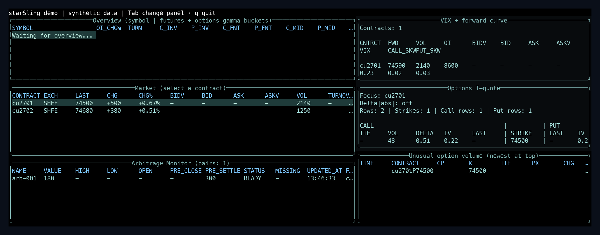

# starSling TUI

A Go terminal workspace for monitoring futures and options. It brings market snapshots, option-chain Greeks, forward pricing, unusual option volume, and spread formulas into a single keyboard-driven view.



*The offline demo uses synthetic copper futures and options. Open the image at full size to read individual columns.*

## Run the offline demo

From a checkout with Go 1.25 or newer:

```sh
go run ./cmd/starsling demo
```

Use **Tab** to change panels and **q** to exit. In the sample, Market shows two futures contracts, Options T-quote shows calls and puts for the selected underlying, and Arbitrage Monitor evaluates the difference between the two futures prices. The demo reads an in-memory snapshot and runs without a broker account.

## Live market data

Run `go run ./cmd/starsling` for the full workspace. Live data uses Python workers and a user-provided OpenCTP-compatible market-data feed. The application guides you through runtime setup, metadata refresh, and feed configuration. Run `go run ./cmd/starsling doctor` for a setup report and `go test ./...` for the Go test suite.

## History and license

This release derives from the February–April 2026 local starSling baseline. It preserves author names and source commit dates. The standalone repository contains filtered history with new commit IDs and uses the original [BSD 3-Clause license](LICENSE).
